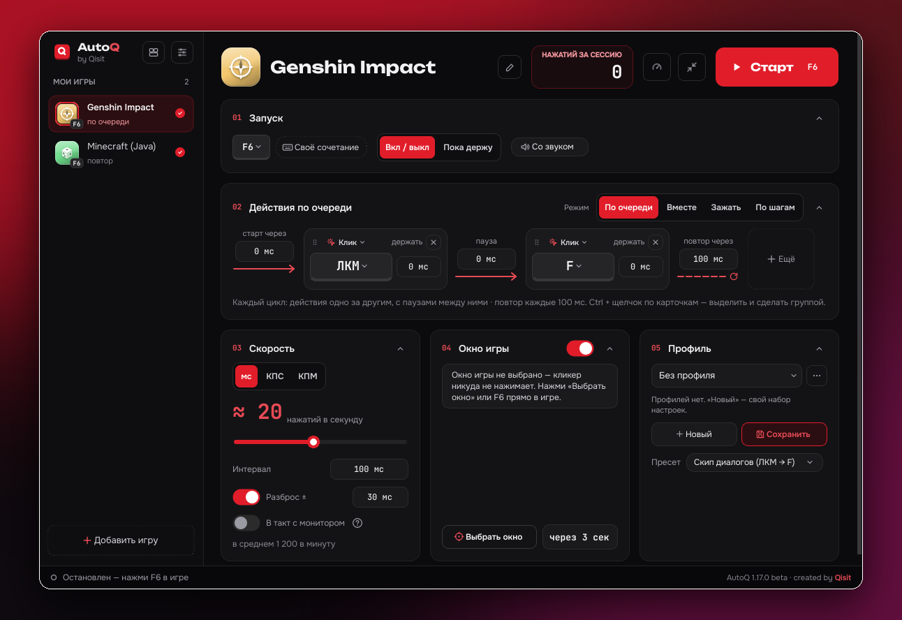

<picture>
  <source media="(prefers-color-scheme: dark)" srcset="docs/images/logo-dark.png">
  <source media="(prefers-color-scheme: light)" srcset="docs/images/logo-light.png">
  
</picture>

  

## Что такое AutoQ?

AutoQ — **автокликер для игр**. Работает на Windows, Linux и macOS.
В нём удобный интерфейс и разные режимы работы.

<i>v1.17.1</i>

## Чем отличается от обычных автокликеров

- **Знает, где игра.** Обычный автокликер жмёт везде, где стоит мышь. AutoQ привязан
  к окну игры, у каждой игры свои настройки и своя клавиша старт/стоп, а несколько
  игр могут работать одновременно.
- **Не только клик.** Мышь и клавиатура вперемешку, удержание, паузы, группы с повтором ×N.
  Режимы «По очереди», «Вместе», «Зажать» и «По шагам», где нажать и отпустить — отдельные шаги.
- **Пресеты и профили.** Например, «Скип диалогов» для Genshin (ЛКМ → F).
  Профили переключаются своей клавишей.
- **Видно, что происходит.** Оверлей КПС поверх игры: клики в секунду, счётчик и график.
- **Свой вид.** Три стиля, редактор карточек прямо в окне, свои цвета. Стиль можно
  сохранить в файл и отдать другу.

## Скачать

**[Последняя версия →](https://github.com/QIISIT/Autoq/releases/latest)**

| Система | Что скачать |
|---|---|
| Windows 10/11 | `…-Windows-Setup.exe` — установщик, или `…-Windows-Portable.zip` — без установки |
| macOS 12+ | `…-macOS.dmg` — одна сборка для Apple Silicon и Intel ([первый запуск](macos/README_MAC.txt)) |
| Linux (X11 / XWayland) | собирается из исходников за пару минут, команда — в описании релиза |

Windows может предупредить о «неизвестном издателе»: «Подробнее» → «Выполнить в любом случае».

## Для разработчиков

Сборка, устройство кода и тесты — в [docs/DEVELOPMENT.md](docs/DEVELOPMENT.md).

## Лицензия

© 2026 Qisit. [PolyForm Noncommercial 1.0.0](LICENSE.md): смотреть, собирать, менять
и делиться можно бесплатно и только не для заработка. Продавать AutoQ или его код,
встраивать в платные продукты и сервисы нельзя без отдельного разрешения автора.
Qt и шрифты — под своими лицензиями, см. [THIRD-PARTY.md](THIRD-PARTY.md).

---

**English.** AutoQ is a game autoclicker that clicks only inside the game window you pick.
Windows, Linux and macOS, Russian and English UI. Get it from
[Releases](https://github.com/QIISIT/Autoq/releases/latest). Free for non-commercial use
under PolyForm Noncommercial 1.0.0.
